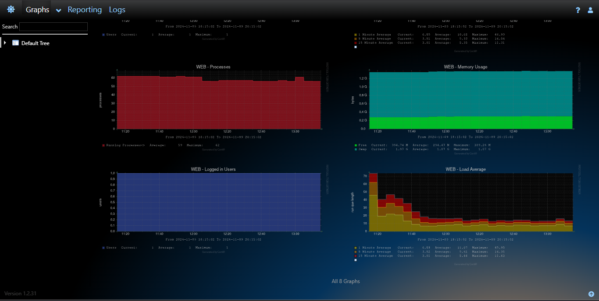
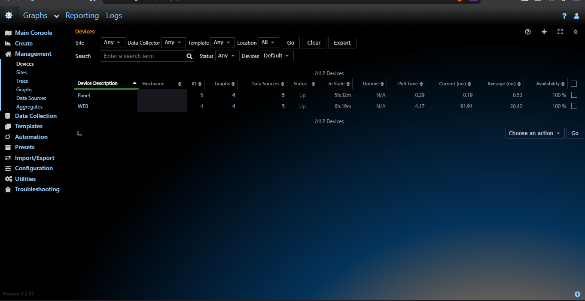

# Server Monitoring with Cacti on Proxmox + HestiaCP

**English** | [Bahasa Indonesia](README.md)

A mini-project documenting server monitoring on a Debian guest in Proxmox, using Cacti hosted through HestiaCP. This guide combines the working deployment details with rewritten installation and troubleshooting notes from the reference practice modules.

> **Evidence boundary:** available screenshots prove server metrics (Processes, Memory Usage, Logged in Users, Load Average) and device reachability/status. They do not prove HTTP request counts, website bandwidth, or unique visitors. Ping and `Up` status are not visitor analytics.

## Verified results

- Cacti shows two devices, `WEB` and `Panel`, both **Up**, each with 4 graphs and 5 data sources.
- Visible server graphs: Processes, Memory Usage, Logged in Users, and Load Average.
- The reported working Cacti deployment uses web root `/home/Qwyv/web/cacti.qyvv.site/public_html`, Linux user `Qwyv`, PHP CLI `php8.5`, a manual poller run with `--force`, and a five-minute cron interval.
- Reference PDFs `2. Modul Cacti` and `4. Troubleshooting Cacti` assume Debian package paths and user (`www-data`, `/usr/share/cacti/site`). Those assumptions **do not match** this HestiaCP deployment and must not be copied as-is.

## Architecture

```text
Proxmox VE
└── Debian guest / HestiaCP
    ├── Cacti web app: /home/Qwyv/web/cacti.qyvv.site/public_html
    ├── Cacti poller: user Qwyv + php8.5 (every 5 minutes)
    ├── Device WEB: qyvv.site
    └── Device Panel: panel.qyvv.site
```

Cacti collects system metrics through the Linux template and checks device reachability. HTTP request/byte metrics require separate access-log collection and Cacti data source/graph configuration.

## Contents

- [Cacti setup on HestiaCP](docs/setup.md)
- [Metric meanings and monitoring limits](docs/metrics.md)
- [Troubleshooting](docs/troubleshooting.md)
- [Screenshot evidence](screenshots/README.md)

## Evidence

**Server graphs:**



**Device status:** hostnames have been redacted.



[Open graph overview](screenshots/cacti-graph-overview.png)

These screenshots prove server metrics and device status only. They do not prove HTTP request counts or unique visitors.

## Security

- Never commit passwords, Cloudflare tokens, database credentials, SNMP communities, or secret configuration.
- Redact IP addresses, email addresses, tunnel IDs, and unnecessary internal hostnames from screenshots.
- Avoid the `public` SNMP community on untrusted networks; restrict SNMP access to required sources.

## Documentation status

Basic server monitoring is supported by Cacti screenshots. HTTP traffic analytics remain unverified.

[Setup](docs/setup.md) · [Metrics](docs/metrics.md) · [Troubleshooting](docs/troubleshooting.md) · [Screenshots](screenshots/README.md)

**Maintainer:** [@rizqi-yusuf](https://github.com/rizqi-yusuf)

Personal learning project. Contributions are not being solicited.

## License

Released under the [MIT License](LICENSE).
