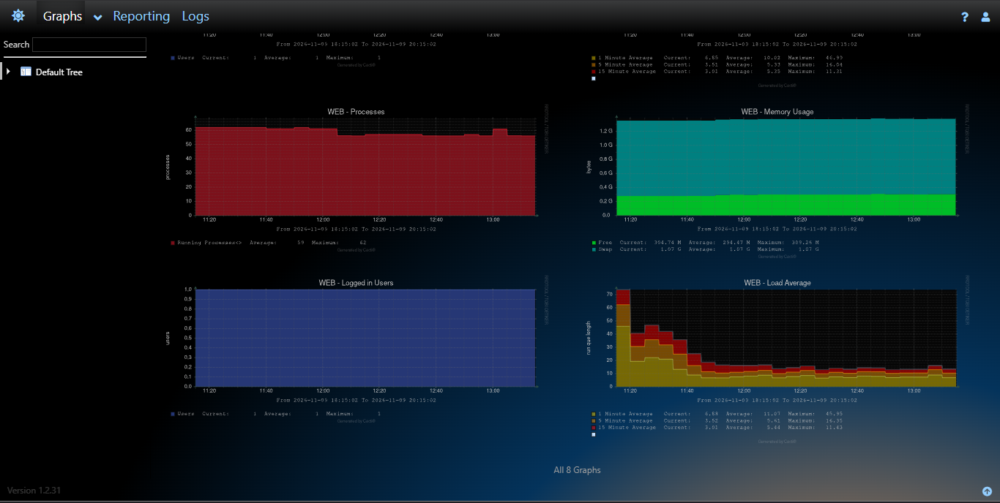
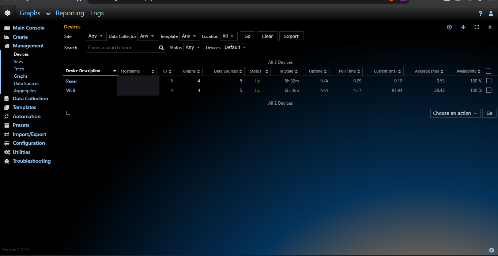

# Monitoring Server dengan Cacti di Proxmox + HestiaCP

[English](README.en.md) | **Bahasa Indonesia**

Dokumentasi mini project pemantauan server pada Debian di Proxmox, dengan Cacti yang di-host melalui HestiaCP. Panduan ini menggabungkan setup yang sudah berjalan dengan catatan praktikum Cacti dan troubleshooting yang ditulis ulang supaya langkahnya bisa diverifikasi.

> **Batasan penting:** grafik yang sudah dibuktikan di screenshot adalah metrik server (Processes, Memory Usage, Logged in Users, Load Average) serta status/reachability device. Belum ada bukti grafik jumlah request HTTP, bandwidth website, atau pengunjung unik. Jangan anggap ping atau status `Up` sebagai analytics pengunjung.

## Hasil terverifikasi

- Dua device Cacti, `WEB` dan `Panel`, terlihat berstatus **Up** dengan 4 graphs dan 5 data sources masing-masing.
- Graphs server yang terlihat: Processes, Memory Usage, Logged in Users, Load Average.
- Setup Cacti yang user laporkan berhasil memakai web root `/home/Qwyv/web/cacti.qyvv.site/public_html`, user Linux `Qwyv`, PHP CLI `php8.5`, poller manual `--force`, dan cron 5-menit.
- PDF referensi `2. Modul Cacti` dan `4. Troubleshooting Cacti` memakai asumsi instalasi paket Debian (`www-data`, `/usr/share/cacti/site`). Asumsi itu **tidak cocok** dengan deployment HestiaCP ini; jangan salin path/owner/cron tersebut mentah-mentah.

## Arsitektur

```text
Proxmox VE
└── Debian guest / HestiaCP
    ├── Cacti web app: /home/Qwyv/web/cacti.qyvv.site/public_html
    ├── Cacti poller: user Qwyv + php8.5 (cron 5 menit)
    ├── Device WEB: qyvv.site
    └── Device Panel: panel.qyvv.site
```

Cacti mengumpulkan metrik sistem melalui template Linux dan memeriksa keterjangkauan host. Metrik HTTP request/bytes memerlukan pengambilan data access log dan konfigurasi data source/graph terpisah.

## Isi

- [Setup Cacti di HestiaCP](docs/setup.md)
- [Memahami graph dan batas metrik](docs/metrics.md)
- [Troubleshooting](docs/troubleshooting.md)
- [Bukti screenshot](screenshots/README.md)

## Bukti hasil

**Graph server:**



**Status device:** hostname disensor sebelum publikasi.



[Open graph overview](screenshots/cacti-graph-overview.png)

Screenshots membuktikan metrik server dan status device. Tidak membuktikan HTTP request counts atau unique visitors.

---

## Keamanan

- Jangan commit password, token Cloudflare, kredensial database, community SNMP, atau konfigurasi rahasia.
- Sensor alamat IP, email, tunnel ID, dan hostname internal yang tidak diperlukan sebelum mengunggah screenshot.
- Hindari community SNMP `public` pada jaringan tidak tepercaya; batasi akses ke sumber yang diperlukan.

## Status dokumentasi

Monitoring server dasar didukung screenshot Cacti. HTTP traffic analytics belum diverifikasi.

[Setup](docs/setup.md) · [Metrics](docs/metrics.md) · [Troubleshooting](docs/troubleshooting.md) · [Screenshots](screenshots/README.md)

**Maintainer:** [@rizqi-yusuf](https://github.com/rizqi-yusuf)

Personal learning project. Contributions are not being solicited.

## License

Released under the [MIT License](LICENSE).
